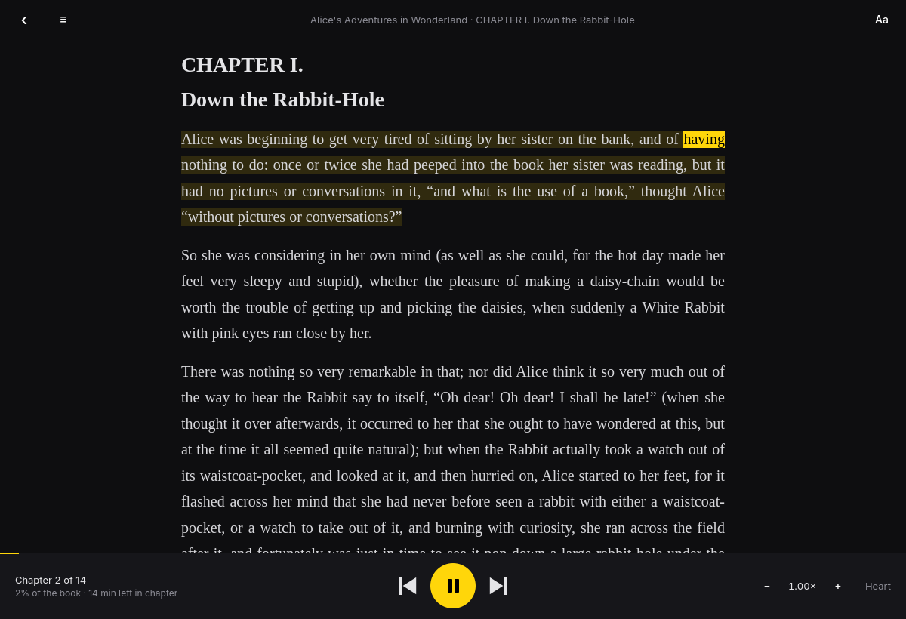

# omareader



An ebook reader for [Omarchy](https://omarchy.org) that reads your books aloud
with [Kokoro](https://huggingface.co/hexgrad/Kokoro-82M) and highlights each
word as it's spoken, so you can follow along. Inspired by
[Readest](https://readest.com), built the way Omarchy's own apps are: one
window, C++ and Qt Quick, driven from the keyboard, following your theme and
language.

Everything runs on your machine. omareader has no accounts and talks to the
network only when you ask it to (setup, and sync if you turn it on):
books are parsed locally and the voice is
[Kokoros](https://github.com/lucasjinreal/Kokoros), a Rust build of Kokoro that
runs on the CPU. If you have an NVIDIA GPU, you can add
[Qwen3-TTS](https://github.com/QwenLM/Qwen3-TTS) as a second voice engine,
for a more natural, expressive reading.

## Install

```sh
git clone https://github.com/looizao/omareader.git
cd omareader
bin/install          # builds it and installs it for you, no sudo
omareader setup      # once: builds Kokoros and downloads the model
```

`bin/install` puts the binary in `~/.local/bin` and the icon and launcher
entry in `~/.local/share`; `bin/install --uninstall` removes them. It needs
the packages in the PKGBUILD's `depends` and prints the `pacman` command for
any that are missing. To install system-wide instead, build the package with
`cd pkgbuild && makepkg -si`, or use the one from a GitHub release.

`omareader setup` is the only step that uses the network. It builds the `koko`
command into `~/.local/bin` from a pinned Kokoros commit and downloads the
Kokoro v1.0 model with word timestamps (about 330 MB) into
`~/.local/share/omareader/models`, checking both downloads against pinned
SHA-256 sums. Run `omareader setup --dry-run` to see what it would do, and
`omareader doctor` to check the result. Building Kokoros needs
`omarchy-pkg-add rust pkgconf opus`.

### Qwen3-TTS (optional)

```sh
omareader setup --engine qwen              # the 0.6B model, fits a 6 GB GPU
omareader setup --engine qwen --model 1.7b # richer, needs about 7 GB free
omareader doctor --engine qwen             # is it ready, and will it fit?
```

This builds a private Python 3.12 environment with PyTorch in
`~/.local/share/omareader/qwen` (about 14 GB, mostly CUDA libraries) and
downloads the CustomVoice model and the forced aligner, which times each
spoken word, into `~/.local/share/omareader/models/qwen`. Every package and
model file is pinned to a version and checked against its SHA-256 sum, and
rerunning the setup keeps what is already there and verified. It needs
`omarchy-pkg-add uv curl`. Afterwards Qwen3-TTS runs fully offline.

It wants an NVIDIA GPU with about 4 GB free for the 0.6B model;
`omareader doctor` says how much is free and what that means. Without enough,
it runs on the CPU, about three times slower than real time: fine for an
export left running, too slow to listen along. Kokoro stays the default and
keeps working whatever happens to Qwen3-TTS, and omareader never switches
engines on its own.

omareader then shows up in the app launcher (Super + Space). You can also run
`omareader book.epub`.

## Books

| Format | How it opens |
| --- | --- |
| EPUB | Parsed directly, with the table of contents and cover |
| PDF | Text through poppler's `pdftotext`, reflowed into paragraphs |
| FB2, DOCX, ODT | Parsed directly |
| Markdown, HTML, plain text | Parsed directly; Project Gutenberg headers are dropped |
| MOBI, AZW3 and other Kindle formats | Converted once through Calibre's `ebook-convert`, if installed |

Every format becomes the same reflowable text in your chosen size, spacing,
column width and typeface. Books are never modified or copied; the library
only remembers where they are and where you stopped.

## Pasted text

For an article, a note or a message with no book file, press N in the library
(or Ctrl+V to paste the clipboard straight in), or click Add text. The text is
saved in `~/.local/share/omareader/texts`, readable only by you, and reads
aloud like any book, with its place remembered. Removing it (Delete, or the
× on its card, after a confirmation) moves it to the trash, so it can still
be restored.

Pasted text is read as Markdown, as text from chat apps and notes often is:
`**bold**`, `*italic*`, `` `code` ``, `~~struck~~`, headings, lists and links
show formatted, and the voice reads the words, never the marks. Headings stay
headings, but the text stays one chapter. Code blocks are skipped, as in
Markdown books. Lines with no blank line between them stay
separate paragraphs.

The title starts as the text's first few words (or its heading, when it opens
with one), and you can type your own.
If a coding agent with a read-only headless mode is installed (Claude Code,
Codex, Gemini or Cursor, with Omarchy's default agent first), the dialog
offers to have it suggest a title. That is off until you tick it, because the
agent sends the start of the text to its provider; omareader itself still
makes no network connection. The agent runs one turn in an empty folder with
no tools, and if it isn't signed in, fails or takes longer than 45 seconds,
the first words stay as the title.

## Reading aloud

Press Space. Kokoros synthesises ahead of you in batches of sentences, and as
each sentence plays, its words light up in the theme's accent. Click any word
to start reading from there. The view follows the voice; scroll away and it
stays put until you press F.

Kokoro's voices cover American and British English, Spanish, French, Hindi,
Italian, Japanese, Brazilian Portuguese and Mandarin; pick one that matches
the book's language. Qwen3-TTS has nine voices that each read English,
Portuguese, Spanish, French, German, Italian, Russian, Chinese, Japanese and
Korean; pick the language separately.

Press A for the voice settings. Engine, voice, language and speed sit at the
top, with a preview button and a reset to the recommended settings. Advanced
opens the rest, each with its range, current value and what it does: pauses
and volume for both engines, a second voice to blend for Kokoro, and for
Qwen3-TTS the model, the device, how varied the intonation is, and a take
number for another reading of the same text. Each engine remembers its own
settings. Changing one while reading rebuilds the audio ahead from the
sentence you are on.

## Exporting audio

Press E (or the ⤓ button) to turn the whole book into audio for your phone, a
podcast app or an audiobook player. Choose one file with chapter markers or a
folder with one file per chapter, as MP3 (plays everywhere) or M4B (an AAC
audiobook), or a bundle for omareader on Android, which highlights the words
as they play (see below). The files use the voice and speed you read with, carry the title,
author, track numbers and cover, and land in `~/Music/Audiobooks` unless you
pick another folder.

The voice reads the whole book first, which takes a while for a long book
(Kokoros runs several times faster than real time on a recent CPU, Qwen3-TTS
about twice as fast on a laptop GPU). An export keeps the voice settings it
started with, whatever you change afterwards. The export keeps
going after you close the dialog, at a lower priority so reading aloud stays
smooth. It is built in a hidden folder and renamed into place at the end, so
a cancelled export leaves nothing behind and an earlier export is never
replaced. Exports need `ffmpeg`.

## On your phone

`android/` is omareader for Android: the same read-along, from audio the
desktop already made. The phone synthesises nothing, so it needs no model
and no GPU. It uses the network only for sync, and only once you
connect it.

1. On the desktop, press E and choose **omareader for Android**. The export
   is one `.omabook` file: each chapter's audio as AAC, the text, and the time
   of every word (the format is in [docs/omabook.md](docs/omabook.md)).
2. With sync on (below), that's all: the book arrives on the phone
   by itself. Otherwise save it into a Google Drive or Dropbox folder, or
   copy it over any way you like.
3. On the phone, open the file from Drive or Dropbox with omareader, or press
   + in the app and pick it. The book is copied into the app.

Press play and the words light up as they are heard, like on the desktop.
Tap a word to read from there; scroll away and the view stays put until you
tap **Back to the voice**. The buttons move by chapter and by sentence, and
the speed and text size are in the top bar. Playback carries on with the
screen off, with the lock screen, headphone and Bluetooth controls, and each
book remembers where it stopped. Exporting a book again, with another voice or
speed, replaces it on the phone and keeps your place.

### Sync through Dropbox or Google Drive

Connect Dropbox or Google Drive (the same one on both) in the desktop's
settings (A, at the bottom) and in the phone's sync screen (the arrows
beside +), and the two keep in step:

- Books you export for the phone go to it, and download there on Wi-Fi
  (or on mobile data, if you allow it).
- Your place in each book follows you, both ways. When the desktop jumps to
  where you stopped on the phone, it says so.
- Removing a book on one removes it from the other.
- The listening speed is shared; the text size is kept per kind of device.

Whichever change was made last wins. omareader sees only its own files:
`Apps/omareader` in your Dropbox, or a folder named `omareader` in your
Google Drive, where it can reach only the files it made. The desktop keeps
the sign-in in your keyring; on the phone Dropbox's is in the Android
Keystore and Google's stays with Google Play services. Disconnecting
revokes it. Sync runs at
start, when you come back to the window, shortly after a change and every
15 minutes. `omareader sync status` shows how it's going. The details are in
[docs/sync.md](docs/sync.md).

In the car, omareader shows up in Android Auto as a media app: your books
as a grid of covers with how far you have got, each playing from where you
left it at your reading speed. The chapters are in the queue, the buttons
beside play go back 10 seconds and forward 30, and "Hey Google, play Dune on
omareader" finds a book by its title or author. Pressing play when the car
connects, or on headphones with the app closed, picks up the last book.

The app is about 0.8 MB: Kotlin with the platform's own views and Media3's
player trimmed to AAC audio, no AppCompat, Compose or other libraries. To
install it on a phone with USB debugging on, run `bin/android install`; the
release is signed with your debug key unless `android/keystore.properties`
names another (`storeFile`, `storePassword`, `keyAlias`, `keyPassword`).

Beta testers get it from Google Play's internal testing track: each release,
or a run of CI with **play** ticked, sends the build there. Setting that up
is in [docs/play.md](docs/play.md); the privacy policy Play links to is
[docs/privacy.md](docs/privacy.md).

## Keyboard

| Key | Action |
| --- | --- |
| Space | Read aloud, pause, resume |
| Click a word | Read aloud from there |
| `,` / `.` | Previous / next sentence |
| `[` / `]` | Slower / faster |
| S | Stop reading aloud |
| F | Back to the voice after scrolling |
| ← / → (or H / L) | Previous / next chapter |
| ↑ ↓ (or K / J), PgUp, PgDn | Scroll |
| T | Contents |
| A | Voice and appearance |
| E | Export as audio |
| + / − | Bigger / smaller text |
| O | Open a book |
| N, Ctrl+V | In the library: add pasted text |
| B or Backspace | Back to the library |
| Enter, Delete | In the library: open, remove a book after a confirmation (the file stays; pasted text goes to the trash) |
| Esc | Close panels and messages |
| ? | Show every shortcut |
| Q | Quit |

## Command line

The commands need no display, so scripts and coding agents can use them. Each
exits 0 or 1 with errors on stderr, and `--json` prints one JSON object.

```sh
omareader info book.epub --json          # metadata and chapters
omareader text book.epub --chapter 3     # the text as omareader reads it
omareader export book.epub --split       # audio, one MP3 per chapter
omareader export book.epub --format m4b  # one M4B audiobook with chapters
omareader export book.epub --format omabook  # for omareader on Android
omareader export book.epub --engine qwen --voice ryan --tune temperature=0.7
omareader voices --engine qwen           # voices, languages and tuning ranges
omareader doctor --json                  # is read-aloud ready?
omareader sync status                    # sync, if connected
omareader skill install                  # agent skill for ~/.claude/skills
```

## How it works

- `src/bookloader.cpp` reduces every format to chapters of plain paragraphs;
  `src/book.cpp` splits those into sentences and words.
- `src/kokoro.cpp` runs `koko file` with `--timestamps` on a batch of
  sentences, one per line, and picks up each sentence's WAV and word-timing TSV
  as Kokoros writes them. Kokoros would download a missing model by itself, so
  omareader only starts it once both model files are already on disk.
- `src/qwen-worker.py` keeps Qwen3-TTS loaded in one Python process for the
  whole app; `src/qwen.cpp` feeds it batches of sentences, whatever someone
  is listening to first and exports in the gaps, and cancels what nobody
  needs any more. The forced aligner gives each word its real start and end.
- `src/synthesizer.cpp` puts both engines behind one contract, a sentence's
  audio plus its word timings, which narration, the preview and exports all
  use. It applies the speed (Qwen3-TTS is time-stretched, its word times
  scaled to match) and the volume.
- `src/voicesettings.cpp` lists each engine's voices, languages and tuning,
  with ranges and recommended values, and remembers them per engine.
- `src/speech.cpp` matches the spoken words back onto the words on the page and
  decodes the audio; `src/narrator.cpp` plays the sentences as one stream and
  maps the playback position to the word being heard.
- `src/library.cpp` keeps pasted text as small JSON files the loader reads
  like plain text; `src/titleagent.cpp` asks a coding agent for a title.
- `src/highlight.cpp` colours that word inside the paragraph without changing
  its layout.
- `src/exporter.cpp` synthesises the book for exports and pipes the
  samples into `ffmpeg`, then joins the chapters into one file with chapter
  markers, or keeps them as a folder of tracks. For the phone it also keeps
  every word's time, and `src/zipwriter.cpp` packs the chapters' audio and
  text into one `.omabook`.
- `src/syncstate.cpp` and `src/syncengine.cpp` merge each book's place and
  presence, and the settings, as timestamped registers where the newest
  change wins; `src/oauth.cpp` signs in through the browser and keeps the
  access token fresh, `src/dropbox.cpp` and `src/drive.cpp` speak Dropbox's
  and Google Drive's APIs, and `src/sync.cpp` runs a sync on a worker
  thread and applies what came back. The Android side (`Sync.kt`,
  `SyncEngine.kt`, `Dropbox.kt`, `Drive.kt`) does the same
  against the same fixtures (`android/app/src/test/resources/sync`).
- `android/` imports a bundle into the app's storage
  (`BundleImporter.kt`), plays it in a media session service
  (`PlaybackService.kt`), and on each frame looks up the word at the playback
  position by binary search and moves one highlight span
  (`ReaderActivity.kt`).

## Development

```sh
bin/build        # build/omareader
bin/test         # Qt Test suite, offscreen
bin/install      # ~/.local/bin and ~/.local/share, no sudo
bin/android test     # the Android app's unit tests and lint
bin/android install  # build the APK and install it over adb
bin/android device-test  # the tests that need Android, on an emulator
bin/android bundle   # the signed bundle for Google Play
bin/android publish  # send it to Play internal testing (docs/play.md)
```

The Android build needs a JDK and the Android SDK (`ANDROID_HOME`, or
`~/Android/Sdk`); the Gradle wrapper fetches the rest.

Sync needs a Dropbox app (set up as in [docs/sync.md](docs/sync.md)) whose
key goes in `DROPBOX_APP_KEY`; both builds read it, and leave sync out when
it is empty. `OMAREADER_DROPBOX_KEY` overrides it at run time on the
desktop. Google Drive needs a Google Cloud project with a desktop and an
Android client (same doc): the desktop client's id goes in
`GOOGLE_CLIENT_ID`, and its secret in `GOOGLE_CLIENT_SECRET`, which git
ignores and CI writes from the repository secret of the same name. The
Android build turns Drive on when `GOOGLE_CLIENT_ID` is set.

CI builds and tests every push and pull request in an Arch Linux container,
builds the package, and tests and builds the Android app. To release, run `bin/release 0.2.0` on a clean main: it
bumps `VERSION` and the PKGBUILD and pushes, and CI tags `v0.2.0` and publishes
a GitHub release with the source tarball, the Arch package, and a PKGBUILD
that builds from the tarball.

## License

MIT. The theme, language and file-chooser code follows Omacut and Monologue by
David Heinemeier Hansson, also MIT.
